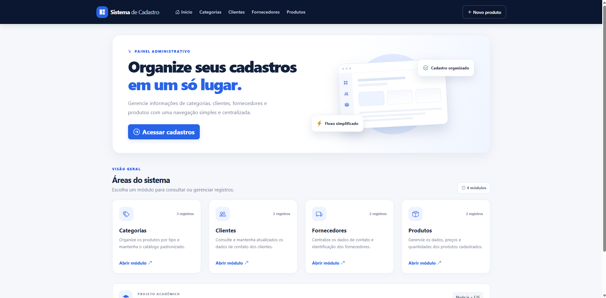
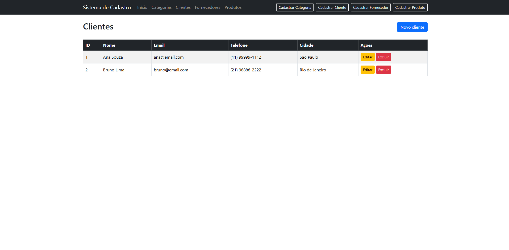

# Sistema de Cadastro — CRUD Node.js

Aplicação web acadêmica para cadastrar, consultar, editar e excluir Categorias, Clientes, Fornecedores e Produtos. O projeto mantém Node.js, Express, EJS e Bootstrap e apresenta um painel administrativo responsivo.

## Integrantes

- Guilherme Andraz
- Pedro Ailton
- Turma: 2DS

> Os nomes foram mantidos conforme a identificação encontrada na versão do projeto recebida. Corrija esta seção caso a composição oficial do grupo seja diferente.

## Objetivo

Praticar desenvolvimento web com renderização de páginas EJS, rotas Express, operações CRUD, validação de formulários, organização de componentes reutilizáveis e publicação de uma aplicação web.

## Visão geral

Este projeto centraliza e organiza os cadastros de categorias, clientes, fornecedores e produtos em uma única interface administrativa.



## Tecnologias utilizadas

- **Node.js** — ambiente de execução JavaScript.
- **Express 4** — servidor HTTP, middleware e rotas.
- **EJS 3** — renderização de templates no servidor.
- **Bootstrap 5.3** — componentes e grid responsivo.
- **Bootstrap Icons** — ícones da interface.
- **CSS e JavaScript** — identidade visual, interações e confirmação de exclusão.
- **JSON local** — armazenamento de desenvolvimento quando as variáveis Supabase não estão configuradas.
- **Supabase REST API** — opção de armazenamento persistente para o deploy.
- **Node.js Test Runner** — testes automatizados (`node:test`).

## Funcionalidades

Todas as entidades usam as rotas de listagem, cadastro, edição e exclusão, preservando os caminhos principais existentes:

| Entidade | Dados principais | Operações |
|---|---|---|
| Categorias | Nome | Criar, listar, editar e excluir |
| Clientes | Nome, e-mail, telefone e cidade | Criar, listar, editar e excluir |
| Fornecedores | Razão social, CNPJ, e-mail, telefone e cidade/endereço | Criar, listar, editar e excluir |
| Produtos | Nome, descrição, preço, estoque e categoria | Criar, listar, editar e excluir |

Também há pesquisa por texto nas listagens, mensagens de retorno, validação no servidor, telas de erro 404/500, confirmação antes de excluir e indicadores da página inicial baseados nas quantidades efetivamente lidas do armazenamento ativo. No layout de celular, a tabela fica dentro de uma área com rolagem horizontal controlada.

## Pastas

```text
Nodejs--navega-o-EJS-main/
├── app.js
├── package.json
├── package-lock.json
├── .env.example
├── .gitignore
├── data/
│   └── store.js
├── docs/
│   ├── evidencias/
│   ├── prompt-utilizado.md
│   └── schema-supabase.sql
├── public/
│   ├── css/
│   │   └── app.css
│   └── js/
│       └── app.js
├── routes/
│   ├── categoriaRoutes.js
│   ├── clienteRoutes.js
│   ├── crudFactory.js
│   ├── entityConfig.js
│   ├── fornecedorRoutes.js
│   └── produtoRoutes.js
├── test/
│   └── app.test.js
└── views/
    ├── entities/
    ├── errors/
    ├── partials/
    └── index.ejs
```

## Uso da Inteligência Artificial

A IA foi utilizada como apoio para revisar a estrutura existente, identificar operações CRUD incompletas, sugerir uma organização reutilizável de rotas e templates, melhorar a experiência visual, escrever validações, preparar testes e estruturar a documentação. As mudanças presentes nesta cópia são as alterações aplicadas no código durante esta execução; não significam que o GitHub ou a aplicação publicada tenham sido atualizados.

## Alterações sugeridas pela IA

- Completar o CRUD de Categorias e padronizar as operações das quatro entidades.
- Consolidar listagem e formulário em templates EJS compartilhados.
- Criar uma identidade visual consistente, responsiva e com melhor hierarquia de informação.
- Validar entradas, tratar IDs inexistentes, mostrar estados vazios e confirmar exclusões.
- Adicionar testes automatizados para as rotas CRUD.
- Separar armazenamento local de uma opção de banco persistente e documentar os limites da Vercel.
- Atualizar o README e reservar locais para evidências reais.

## Alterações implementadas no código

- Criados `routes/crudFactory.js` e `routes/entityConfig.js` para padronizar as rotas e os campos das quatro entidades.
- Implementado CRUD completo para Categorias, Clientes, Fornecedores e Produtos, com tratamento de IDs inválidos/inexistentes e validação de campos.
- Criados templates compartilhados para listagem e formulários de cadastro/edição.
- Redesenhados painel inicial, navegação, tabelas, formulários, estados vazios, feedbacks e páginas de erro.
- Criado `public/css/app.css` com layout responsivo e `public/js/app.js` com confirmação de exclusão.
- Criado um armazenamento JSON local para desenvolvimento e integração opcional com Supabase REST API para persistência no deploy.
- Adicionados `docs/schema-supabase.sql`, `.env.example` e testes em `test/app.test.js`.
- Alterado `app.js` para exportar a aplicação Express e permitir inicialização local e detecção pelo runtime da Vercel.

## Alterações manuais realizadas pelo grupo

**Preencher pelos integrantes após revisar e testar esta versão.** Não foi possível inferir, somente a partir do ZIP original, quais edições manuais o grupo realizou depois da assistência da IA.

- Ajustes manuais no código: `[descrever ou informar “nenhum”]`
- Revisões ou correções realizadas pelo grupo: `[descrever]`
- Pessoa responsável e data: `[preencher]`

## Prints da conversa com a IA

Inserir nesta seção capturas reais da conversa que mostrem o prompt, as recomendações e as revisões feitas pelo grupo. Não foram inventadas capturas de conversa.

- `[PENDENTE]` `docs/evidencias/conversa-ia-01.png` — prompt/recomendações.
- `[PENDENTE]` `docs/evidencias/conversa-ia-02.png` — revisão e validação do resultado.

## Antes da reestilização

As duas imagens abaixo foram fornecidas junto ao projeto e registram a interface anterior.

### Página inicial original


### Listagem de clientes original



## Depois da reestilização

**Captura real ainda pendente.** Depois de iniciar a versão atualizada no navegador, capture a página inicial e uma listagem e salve-as como:

- `docs/evidencias/depois-pagina-inicial.png`
- `docs/evidencias/depois-listagem-clientes.png`

Não há captura “depois” incluída nesta entrega, pois a versão atual não pôde ser executada visualmente neste ambiente sem as dependências instaladas.

## Aplicação e repositório

- **Aplicação publicada:** https://nodejs-navega-o-ejs.vercel.app/
- **Repositório:** https://github.com/guiguix7/Nodejs--navega-o-EJS

> A URL publicada permanece a mesma, mas esta entrega não enviou alterações para o GitHub nem fez novo deploy. A versão publicada pode continuar mostrando o código anterior até que estas alterações sejam enviadas e publicadas.

## Como executar localmente

Requer Node.js 20 ou superior.

```bash
npm install
npm run dev
```

Abra `http://localhost:3005`. Para iniciar sem Nodemon, use `npm start`. Na primeira execução sem o Supabase configurado, o projeto cria `data/cadastros.json` com registros de demonstração; esse arquivo é ignorado pelo Git. É possível escolher outro caminho por meio de `DATA_FILE`.

Para executar os testes automatizados:

```bash
npm test
```

Os testes usam um arquivo separado em `/tmp` e exercitam criação, listagem/pesquisa, edição, exclusão e tratamento de IDs inexistentes nas quatro entidades, além da validação de obrigatoriedade. O teste requer que as dependências estejam instaladas.

## Persistência e configuração da Vercel

O modo JSON é apropriado para desenvolvimento local, mas **não garante persistência em hospedagem serverless**. Sem banco externo, a aplicação na Vercel utiliza um arquivo em `/tmp`, que pode ser descartado em novas instâncias ou reinicializações. Não use esse modo para dados que precisem ser mantidos.

Para habilitar persistência com Supabase:

1. Crie um projeto Supabase.
2. Abra o SQL Editor e execute o arquivo [`docs/schema-supabase.sql`](docs/schema-supabase.sql). Ele cria as quatro tabelas usadas pela aplicação.
3. Em **Project Settings → API**, copie a URL do projeto e a chave `service_role`.
4. No painel da Vercel, abra **Settings → Environment Variables** e configure `SUPABASE_URL` e `SUPABASE_SERVICE_ROLE_KEY` para os ambientes desejados. Não coloque essa chave no JavaScript do navegador, no HTML, em repositório público ou em capturas de tela.
5. Faça um novo deploy e valide cada operação CRUD na URL publicada.

Para desenvolvimento local com banco persistente, crie um arquivo `.env` a partir de `.env.example` e preencha as duas variáveis. O Node.js puro não carrega `.env` automaticamente; pode exportar as variáveis no terminal antes de iniciar o projeto ou usar uma ferramenta própria para isso. Não envie `.env` ao GitHub.

A aplicação não possui login ou controle de acesso. Em um deployment público, qualquer pessoa que alcance as rotas pode tentar cadastrar, editar e excluir dados. Use apenas dados de demonstração nesse cenário e implemente autenticação/autorização antes de armazenar informações reais. A chave `service_role` precisa permanecer exclusivamente no ambiente do servidor.

A Vercel atualmente suporta aplicações Express exportadas como aplicação CommonJS (consulte a [documentação oficial do Express na Vercel](https://vercel.com/docs/frameworks/backend/express)); `app.js` exporta `module.exports = app` e só abre um listener local quando executado diretamente. Os arquivos estáticos ficam em `public/`, que é o diretório esperado pela Vercel. Não foi adicionado `vercel.json` porque a detecção atual de Express é feita automaticamente; caso o projeto vinculado tenha configurações personalizadas no painel, confira-as antes de publicar.

## Testes e limitações desta entrega

- [x] Análise dos arquivos extraídos do ZIP original.
- [x] Implementação das rotas CRUD e dos templates compartilhados no código-fonte.
- [x] Criação de teste automatizado para o CRUD das quatro entidades.
- [x] Inclusão de esquema SQL para persistência via Supabase.
- [ ] Execução de `npm install` e `npm test`: pendente neste ambiente porque a tentativa de instalar dependências excedeu o tempo limite de rede.
- [ ] Verificação visual em navegador e captura “depois”: pendente.
- [ ] Teste com credenciais reais de Supabase: pendente.
- [ ] Teste na URL publicada e novo deploy: pendente; não foram executados nesta entrega.

## Arquivos de referência

- Prompt completo: [`docs/prompt-utilizado.md`](docs/prompt-utilizado.md)
- SQL para Supabase: [`docs/schema-supabase.sql`](docs/schema-supabase.sql)
- Variáveis de ambiente de exemplo: [`.env.example`](.env.example)
- Testes automatizados: [`test/app.test.js`](test/app.test.js)

## Prompt Utilizado

O texto integral do prompt fornecido para orientar a IA está incluído abaixo e também disponível em [`docs/prompt-utilizado.md`](docs/prompt-utilizado.md).

<details>
<summary>Expandir o prompt completo</summary>

Você é um desenvolvedor full-stack experiente, especializado em Node.js, Express, EJS, Bootstrap, design de interfaces e experiência do usuário (UX/UI).

Quero que você analise, corrija, desenvolva e reestilize um projeto que já existe. **Não crie outro projeto do zero. Trabalhe sobre o código atual, preserve as funcionalidades que já funcionam e implemente as melhorias necessárias.**

## 1. Informações do projeto

**Repositório GitHub:** https://github.com/guiguix7/Nodejs--navega-o-EJS  
**Aplicação publicada:** https://nodejs-navega-o-ejs.vercel.app/  
**Tecnologias atuais:** Node.js, Express, EJS e Bootstrap.  
**Contexto:** trabalho escolar de desenvolvimento web da turma 2DS, com o objetivo de finalizar todas as operações CRUD e reestilizar a aplicação com o auxílio de Inteligência Artificial.

## 2. Objetivo principal

Transformar o atual Sistema de Cadastro em uma aplicação web mais moderna, profissional, organizada, intuitiva e responsiva, mantendo sua finalidade original.

Você deverá executar duas tarefas principais:

1. Finalizar e corrigir as funcionalidades CRUD.
2. Fazer um redesign completo da interface, melhorando a estrutura, a organização, a navegação e a experiência do usuário.

**Importante:** mudar somente as cores não é suficiente. Quero uma mudança visual perceptível, com melhoria na disposição dos elementos, nos formulários, nas tabelas, nos botões, na navegação e na apresentação geral do sistema.

## 3. Etapa 1 — Análise do projeto existente

Antes de modificar o código, examine os arquivos do repositório, incluindo `app.js`, `package.json`, arquivos dentro de `routes`, arquivos dentro de `views`, arquivos EJS de cadastro, edição e listagem, componentes compartilhados como a navegação, arquivos CSS, JavaScript e imagens existentes, configurações utilizadas na publicação pela Vercel e `readme.md` ou `README.md`.

Identifique quais funcionalidades já existem, quais apresentam problemas, quais estão incompletas e quais arquivos precisarão ser modificados ou criados.

Não se limite a apresentar uma análise: depois de identificar os problemas, implemente as soluções.

## 4. Etapa 2 — Finalização do CRUD

Garanta que todas as quatro operações CRUD funcionem corretamente para **Categorias, Clientes, Fornecedores e Produtos**.

### Create — Cadastrar
- Permitir o cadastro de novos registros.
- Criar formulários organizados, com campos identificados.
- Validar campos obrigatórios.
- Validar formatos e tipos de dados quando necessário.
- Mostrar mensagens claras de sucesso ou de erro.

### Read — Listar
- Exibir os registros cadastrados em tabelas organizadas.
- Mostrar corretamente todos os dados relevantes de cada entidade.
- Apresentar uma mensagem amigável quando não houver registros.
- Organizar as colunas e os controles de cada tabela.
- Disponibilizar pesquisa ou filtro quando for viável.

### Update — Editar
- Criar ou corrigir as telas de edição.
- Preencher os formulários com os dados atuais do registro.
- Permitir alterar os campos e salvar as modificações.
- Atualizar o registro correto sem duplicá-lo.
- Retornar à listagem após a atualização.
- Informar quando o registro não existir.

### Delete — Excluir
- Criar ou corrigir a exclusão de registros.
- Pedir confirmação antes de excluir.
- Excluir somente o registro selecionado.
- Atualizar a listagem depois da exclusão.
- Mostrar mensagens adequadas de sucesso ou erro.

Verifique especialmente se **Categorias também possui edição e exclusão completas**, além de cadastro e listagem.

Mantenha as rotas coerentes com a estrutura atual do projeto e evite quebrar os caminhos que já são utilizados pela aplicação.

## 5. Etapa 3 — Redesign completo da interface

Desenvolva uma identidade visual moderna para o sistema, inspirada em painéis administrativos profissionais.

### Direção visual
Utilize uma interface limpa, organizada e consistente, com fundo claro e discreto; cores principais sóbrias, como azul-marinho, branco e azul; uma cor de destaque consistente; tipografia legível; espaçamento adequado; cantos arredondados com moderação; sombras sutis; ícones apropriados; hierarquia visual clara; e bom contraste entre textos e fundos.

Você pode utilizar Bootstrap e CSS personalizado. Evite instalar bibliotecas desnecessárias ou trocar toda a tecnologia existente.

### Página inicial
Transforme a página inicial em um painel administrativo com cabeçalho moderno, nome do sistema, apresentação breve da finalidade da aplicação, cartões ou blocos visuais para Categorias, Clientes, Fornecedores e Produtos, ícones para cada módulo, botões claros para acessar cada área, indicadores com quantidades reais de registros caso possam ser obtidos corretamente, e identificação da equipe e da turma em uma área discreta. Não utilize números fictícios para simular estatísticas.

### Navegação
Crie uma navegação consistente entre as páginas, com links para os quatro módulos. A navegação deve funcionar em telas pequenas e grandes. Pode utilizar uma barra superior ou uma barra lateral responsiva, desde que seja compatível com o projeto atual.

### Telas de listagem
Reestilize todas as telas de listagem: título e descrição da seção; botão de cadastro em destaque; tabelas com cabeçalhos claros; linhas bem espaçadas; botões de editar e excluir visualmente distintos; estados vazios com orientação; pesquisa por texto quando aplicável; tabelas adaptadas a dispositivos móveis. Em telas pequenas, evite que a tabela ultrapasse descontroladamente os limites da página.

### Formulários de cadastro e edição
Padronize os formulários com títulos que indiquem a ação atual; rótulos claros; campos com largura e espaçamento adequados; validações e mensagens de erro compreensíveis; botões de salvar e cancelar; organização lógica dos campos; e indicação visual de obrigatoriedade. Mantenha os campos e dados próprios de cada entidade.

### Experiência do usuário
Implemente feedback visual após operações, confirmação de exclusão, botões com estados de interação, mensagens para formulários inválidos, navegação intuitiva, foco visível nos elementos interativos e consistência entre as páginas. O resultado deve parecer um único sistema.

## 6. Etapa 4 — Qualidade e compatibilidade técnica

Preserve Node.js, Express e EJS; reaproveite Bootstrap; evite duplicação; crie componentes EJS compartilhados quando útil; mantenha nomes de arquivos e rotas coerentes; trate IDs inválidos e registros inexistentes; evite erros de sintaxe; utilize interpolação escapada do EJS para dados fornecidos pelo usuário; não remova funcionalidades sem justificativa; não invente funcionalidades; e não simule operações bem-sucedidas.

Analise como os dados são armazenados. Caso o sistema utilize arrays em memória, avalie as consequências na Vercel. Se for necessária persistência para o deploy, apresente a alternativa simples, explique as configurações e não invente credenciais. Não afirme que os dados ficam armazenados permanentemente se isso não estiver implementado.

Garanta compatibilidade com execução local e hospedagem.

## 7. Etapa 5 — Testes obrigatórios

Depois de implementar, teste todas as entidades. Critérios: página inicial abre; navegação funciona; categorias podem ser cadastradas, listadas, editadas e excluídas; clientes, fornecedores e produtos têm CRUD completo; alterações aparecem nas listagens; campos obrigatórios são validados; registros inexistentes são tratados; confirmação de exclusão funciona; layout funciona em computadores e celulares; não existem erros de sintaxe; projeto inicia localmente; e configuração de publicação foi revisada.

Execute testes automatizados, se houver, e faça verificações manuais possíveis. Não marque como concluído algo que não foi testado.

## 8. Etapa 6 — Atualização obrigatória do README

Atualize o README para incluir: nome do projeto “Sistema de Cadastro — CRUD Node.js”; integrantes existentes; objetivo; tecnologias realmente utilizadas; CRUD disponível para cada entidade; prompt completo utilizado; uso da IA; alterações sugeridas pela IA; alterações implementadas pelo grupo; seção preparada para capturas reais da conversa; captura antes da reestilização; captura depois da reestilização; link da aplicação https://nodejs-navega-o-ejs.vercel.app/; link do repositório https://github.com/guiguix7/Nodejs--navega-o-EJS.

As evidências podem ficar em `docs/evidencias`. Não invente capturas, conversas ou alterações manuais. Deixe indicações claras dos arquivos e imagens que precisam ser preenchidos. Explique separadamente o que foi recomendado pela IA, o que foi aplicado ao código e o que foi ajustado manualmente pelos integrantes.

## 9. Etapa 7 — Preparação para publicação

Verifique a preparação para a Vercel; preserve a URL atual quando possível; confira rotas, estáticos, dependências e inicialização; documente variáveis de ambiente; corrija problemas que impeçam o CRUD; e informe os passos para republicar. Não afirme que publicou, atualizou o GitHub ou executou testes reais sem realizar essas ações.

## 10. Formato da entrega

Apresente resumo dos problemas; arquivos criados ou modificados; CRUD corrigido/implementado; melhorias visuais; relação entre sugestões e alterações; testes e limitações; README atualizado; passos de execução local; passos de publicação; e pendências manuais.

Quando tiver acesso ao ambiente, modifique os arquivos diretamente e apresente o conteúdo completo quando necessário. Não entregue somente exemplos isolados ou pseudocódigo.

**Critério final de sucesso:** manter as funcionalidades existentes, oferecer CRUD completo para Categorias, Clientes, Fornecedores e Produtos, apresentar redesign perceptível, funcionar no ambiente de execução e possuir README com informações e evidências exigidas.

Comece analisando o repositório atual e prossiga com a implementação, sem interromper o trabalho após o diagnóstico.

</details>
